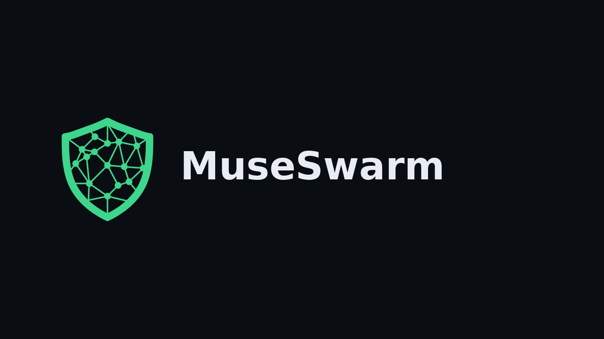

# MuseSwarm

<p align="center">
  
</p>

A scoped policy gate for AI-agent tools - Meta Global AI Developer Hackathon (Indie Track). Not OS-wide antivirus.

**Brand:** [`assets/brand/BRAND.md`](./assets/brand/BRAND.md) · **North star:** [`WIN_PLAN.md`](./WIN_PLAN.md) · Research: [`swarmguard_zero_meta_hackathon_blueprint.md`](./swarmguard_zero_meta_hackathon_blueprint.md) · Meta API: [`meta_model_api_muse_code_expert_guide.md`](./meta_model_api_muse_code_expert_guide.md)

## Claim

**A scoped gate before managed AI-worker effects.**
On November 3, an actual Mac test used muse-spark-1.3 for a useful checklist and two defender roles. Both reviewers allowed the exact useful action before its in-memory artifact was created. A separately planted harmful proposal was vetoed by the first reviewer before its effect; the second review was skipped, and owned-worker stop/removal were checked. Both roles use the same model. This is not a spontaneous hijack, a single-reviewer comparison or whole-computer protection.

Independent network, browser and file enforcement adapters remain unqualified. The Linux network qualification stopped during offline package preparation before the sensor ran. The Mac network test remains unqualified. Separate native AMD64 disposable-namespace research, using single-UID-adapted synthetic rules, passed useful traffic, zero collector bytes, live-sensor lease expiry and listener-loss checks. That is not an ARM64 Docker/OrbStack pass or protection of arbitrary computer traffic. Separate IDE and MCP policy experiments exist, with the limits below. Source includes additional model/vision integrations, but their presence is not verified execution evidence.

```
Cursor / Claude Code  →  IDE hook (hooks/museswarm_pretool.py)
Agent MCP tools       →  MCP proxy (mcp_proxy.py)
                              │ both → policy.py
                              ▼ deny
                       threat_bus + protector UI
```

## What it is

1. **IDE policy hook** — Cursor `.cursor/hooks.json` + Claude Code `.claude/settings.json` run `hooks/museswarm_pretool.py` on PreToolUse / shell / read / MCP; denies `.env` reads and evil curl; logs `policy_deny` with `trigger=ide_hook`
2. **MCP policy proxy** — `mcp_proxy.py` intercepts `tools/call`, runs `policy.evaluate_tool_call`, denies before upstream, logs `policy_deny` incidents
3. **Policy catalog** — 16+ attack classes with no API spend — see `threat_model.py`
4. **Meta review flow** - Muse Spark task and defender-role execution is verified in the fixed managed-worker tests. Wonder and SAM code paths are not claimed as observed submission evidence.
5. **Protector UI** — macOS menu-bar native panel (primary) + optional Streamlit deep console; status + MCP gate heartbeat + activity (IDE hook / MCP policy deny vs Muse quarantine)

The status label confirms policy configuration only, not that IDE hooks have run or that the whole computer is protected. The MCP heartbeat confirms a running wrapper, not coverage of other tools. IDE command matching is heuristic and can be bypassed by scripts or obfuscation. Strict MCP defaults currently deny unrecognized calls, including normal reads; configure/review policy before using it for everyday work.

Prove the gates (free, no Meta tokens):

```bash
python -m unittest discover -s tests -v  # offline stdio, status and mocked analysis regressions
python safe_range/run_enforcement_demo.py   # catalog + rogue
python safe_range/run_mcp_gate_demo.py      # proxy denies .env/exfil; upstream never sees them
python safe_range/run_ide_hook_demo.py      # IDE hook denies Read .env + curl evil
```

### IDE hook install (this repo)

Already checked in:

| Surface | Path |
|---------|------|
| Hook script | `hooks/museswarm_pretool.py` |
| Cursor project hooks | `.cursor/hooks.json` → `python3 hooks/museswarm_pretool.py` (`failClosed: true`) |
| Claude Code project hooks | `.claude/settings.json` → same script via `$CLAUDE_PROJECT_DIR` |

Cursor reloads hooks on save (or restart Cursor). Confirm in **Cursor Settings → Hooks**.
Optional user-wide Cursor install: copy/merge into `~/.cursor/hooks.json` with a command that points at this repo’s absolute script path (project hooks are preferred so other workspaces stay unaffected).

**Honest limits:** the IDE hook soft-allows pure “unknown path/cmd” so normal coding still works; catalog denials (secrets, egress, reverse shells, …) still block. MCP proxy stays hard fail-closed for untrusted tools. Cloud/remote agents may not deliver hook stdin (known Cursor limitation). Hooks only apply where Cursor/Claude Code loads this project’s config.

## Run (menu-bar first)

Primary UX on macOS is the **menu-bar Protector** — quiet AV vibes, native in-app panel (not a browser).

```bash
cd museswarm
./run_menubar.sh
```

1. Look for the **MuseSwarm mark** in the menu bar (`assets/brand/swarmguard-icon-menu.png`) — status suffixes `!` / `·` when denials or enforce-off.
2. Click the status item → **Open Protector** to toggle the native panel (mark + MuseSwarm title, status, MCP gate, recent denials, Refresh, Run free proofs).
3. **Open full console (advanced)…** is optional — launches Streamlit `dashboard.py` in a browser for the deep console.
4. **Refresh the icon:** menu → **Quit MuseSwarm menu**, then `./run_menubar.sh` again. Stale lock only: `rm /tmp/swarmguard-menubar.pid`.

Brand tokens/usage: [`assets/brand/BRAND.md`](./assets/brand/BRAND.md). Original mark generated with **Muse Image** and frozen. Current wordmark uses that unchanged icon; no image generation is needed. Runtime menu bar / Protector panel make **no Muse calls**. Single status item + PID lock (`/tmp/swarmguard-menubar.pid`).

Install rumps into the venv when you can (`rumps` is in `requirements.txt`). If rumps is missing, `run_menubar.sh` falls back to Framework Python 3.13 + AppKit/PyObjC when present.

### Optional deep console (Streamlit)

```bash
source .venv/bin/activate
streamlit run dashboard.py
```

Browser console: **Scoped agent-tool policy**, MCP gate idle/wrapping, activity feed, optional Attack 01 (Meta API credits). The MCP proxy and Cursor/Claude hooks are unchanged — menu bar does not replace them.

The stdio wrapper uses newline-delimited JSON-RPC per the [MCP transport specification](https://modelcontextprotocol.io/specification/2025-06-18/basic/transports). It does not use Content-Length framing.

### Wrap a real (or fake) MCP server

```bash
# Proof / demo upstream
python mcp_proxy.py -- python safe_range/fake_mcp_upstream.py

# Or: python -m museswarm_mcp -- <your-mcp-server> [args...]
```

Env flags:

| Flag | Default | Meaning |
|------|---------|---------|
| `SWARMGUARD_ENFORCE` | `1` | Fail-closed policy |
| `SWARMGUARD_MUSE_ON_AMBIGUOUS` | `0` | Optional low-cost Spark on poisoned `tools/list` / ambiguous results (off = token discipline) |

## Submission demo story (three-minute video)

Final video, publication, organizer terms and submission still require owner review. The recording should show the actual current product and visibly label the November 3 recorded results if reused. A reconstructed evidence reel is supporting material, not a new live product recording.

1. State the exact managed-worker boundary and original computer-protection goal.
2. Show the actual three-item checklist and two same-action approvals.
3. Label the separate harmful proposal as deliberately planted. Show first-reviewer veto, no artifact and verified worker cleanup.
4. Explain what is not covered: arbitrary apps, agents outside this launcher and the unqualified network/browser/file adapters. Do not claim demonstrated Wonder/SAM execution or an independent-model ensemble.
5. State the event-built contribution and next enforcement qualification step, without presenting planned adapters as active.

## Safety

- Policy defaults to `SWARMGUARD_ENFORCE=1`
- Some demos are simulated. The verified managed-worker test stops/removes only its owned container, never an arbitrary host process
- Safe-range canary lab: `safe_range/README.md`

## Meta stack

| Role | Model | Evidence |
|------|--------|----------|
| Task and defender roles | `muse-spark-1.3` | Actual November 3 managed-worker test |
| Forensics integration | `muse-wonder-1.0` | Source path, not claimed as observed execution |
| Vision integration | `sam-3.1` | Source path, not claimed as observed execution |

Analysis reliability: provider calls have a 30-second timeout and no automatic retries. Invalid report fields fall back to explicitly labeled local analysis. Demo quarantine is simulated; SAFE results do not create a quarantine. Offline tests use mocked providers, not Meta API credits.

## Configuration compatibility

Existing `SWARMGUARD_*` settings, `swarmguard_mcp` and
`hooks/swarmguard_pretool.py` remain supported. The `museswarm_mcp` and
`hooks/museswarm_pretool.py` entry points use the same policy implementation.
Keep existing state directories and PID locks in place when updating.
